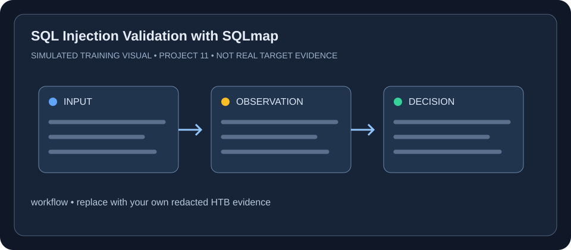

# Project 11: SQL Injection Validation with SQLmap

**Level:** Beginner  
**Environment:** HTB-assigned machine or Academy lab only  
**Status:** Training guide — add your own results after completing the exercise.

## Objective

Use SQLmap to validate a suspected injection point in an HTB lab with tightly limited, read-only checks.

## Scope and authorization

Use only the target IP/hostname assigned to your active HTB lab or an explicitly authorized retired-machine environment. Record machine name, assigned address, start/end time, and HTB rules before testing. Never substitute a public IP or unrelated host.

## Prerequisites and tools

SQLmap; Burp request file; assigned lab URL

- Kali Linux or a dedicated testing VM.
- Active HTB VPN or official browser-based lab environment.
- Create an evidence/ directory for notes and command output.
- Confirmed target identifier and explicit scope.

## Lab procedure

Capture one authorized request in Burp and save it as evidence/request.txt. Run: sqlmap -r evidence/request.txt -p PARAM --batch --risk=1 --level=1 --technique=BEUSTQ --threads=1 --timeout=10 --retries=1. If confirmed, stop at database and current-user identification; do not dump tables or modify data.

## Expected observations

Capture tested parameter, detection technique, DBMS fingerprint if returned, and minimal proof.

## Evidence to capture

1. Screenshot of the HTB machine/lab context with sensitive account details hidden.
2. Terminal or Burp screenshot showing the command/request and relevant output, with tokens, flags, and credentials redacted.
3. Screenshot or note showing manual validation and final conclusion.

The three diagrams below are simulated explanatory visuals. They are not genuine screenshots or claims that a target was tested. Add your own redacted screenshots when you perform the lab.

## Simulated training illustrations

## Findings and risk assessment

| Field | Your evidence |
|---|---|
| Finding | [Confirmed issue, or state none found] |
| Affected asset | [HTB machine and in-scope service] |
| Evidence | [Screenshot filename, command, response excerpt] |
| Impact | [Confidentiality, integrity, availability] |
| Severity | [Informational / Low / Medium / High / Critical, with rationale] |
| Confidence | [Confirmed / Likely / Unconfirmed] |

Do not claim a vulnerability based only on a scanner banner or an unverified hypothesis.

## Remediation guidance

Keep risk and level low; do not use dump, os-shell, file writes, or destructive options. Stop if the target becomes unstable.

Map confirmed weaknesses to applicable CWE or OWASP categories, explain root cause, recommend least-privilege fixes, and identify a safe retest.

## Validation and retest

Repeat the minimal test after remediation. Record before/after behavior, tool versions, timestamps, and limitations. Demonstrate that the original condition is no longer reproducible without introducing new risk.

## Deliverables

- Scope and methodology notes.
- Sanitized command output and three redacted evidence screenshots from your own lab run.
- Confirmed findings with impact and severity rationale.
- Remediation and retest result.

## References

- [Hack The Box](https://www.hackthebox.com/)
- [HTB Academy](https://academy.hackthebox.com/)
- [Nmap Reference Guide](https://nmap.org/book/man.html)
