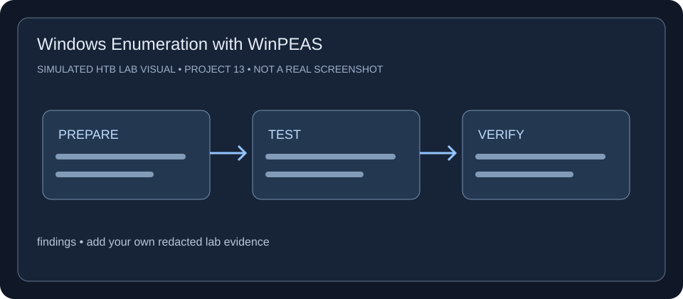

# Project 13: Windows Enumeration with WinPEAS

**Level:** Beginner  
**Environment:** HTB-assigned machine or Academy lab only

## Objective

Use WinPEAS to identify Windows host configuration weaknesses in an HTB lab.

## Scope and authorization

Use only your assigned HTB target or an explicitly authorized retired-machine replica. Record target identity, assigned IP, time window, and platform rules. Do not test unrelated systems.

## Prerequisites and tools

WinPEAS; HTB Windows foothold; PowerShell or cmd

- Dedicated Kali or Windows lab VM as appropriate.
- Active HTB lab access and confirmed scope.
- Evidence folder; keep secrets and flags out of public commits.

## Procedure

Use the official WinPEAS release and verify its source. Run under the current lab user with output saved locally. Review services, scheduled tasks, registry permissions, groups, privileges, installed software, and stored configuration references. Do not extract unrelated secrets.

## Expected outcome

A concise list of manually confirmed configuration issues and their security implications.

## Screenshot and evidence checklist

Capture (1) the HTB lab context with account details obscured, (2) the relevant terminal/Burp output, and (3) manual verification or remediation evidence. The illustrations below are simulated training diagrams, not actual HTB screenshots or proof of execution. Add your own redacted screenshots after completing the exercise.

## Simulated training illustrations

## Findings template

| Item | Record |
|---|---|
| Asset / service | [Assigned HTB target] |
| Observation | [What was directly observed] |
| Evidence | [Redacted screenshot and output filename] |
| Impact | [Confidentiality / integrity / availability] |
| Severity | [Rating and rationale] |
| Confidence | [Confirmed / likely / unconfirmed] |

## Remediation

Recommend least privilege, secure defaults, input validation, patching, segmentation, and logging as applicable to the confirmed root cause. Map to a relevant CWE or OWASP category where appropriate. Do not recommend fixes for unverified scanner output.

## Retest

Repeat the smallest safe test after remediation and record before/after behavior, timestamp, and remaining limitations.

## Deliverables

- Scope and methodology notes.
- Three redacted screenshots from your own lab execution.
- Reproducible finding, impact, severity rationale, and remediation.
- Retest result and sanitized command output.

## References

- [Hack The Box](https://www.hackthebox.com/)
- [HTB Academy](https://academy.hackthebox.com/)
