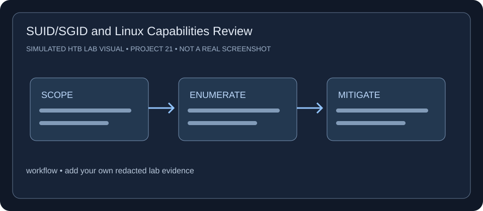

# Project 21: SUID/SGID and Linux Capabilities Review

**Level:** Intermediate  
**Environment:** HTB-assigned machine or Academy lab only

## Objective

Audit privileged executable bits and Linux capabilities for risky configuration.

## Scope and authorization

Use only the assigned HTB target, domain, and lab credentials. Confirm that every host and account is included in the active exercise scope. No credential theft, password spraying, real-world relay, persistence, or out-of-scope lateral movement.

## Prerequisites and tools

find; getcap; stat; id; sudo -l

- Dedicated lab VM and active HTB access.
- Explicit target/domain scope and test identity.
- Evidence directory; redact credentials, hashes, flags, and tokens.

## Procedure

Enumerate SUID/SGID files with find / -perm -4000 -type f 2>/dev/null and find / -perm -2000 -type f 2>/dev/null. Review capabilities with getcap -r / 2>/dev/null. Check ownership, package origin, and intended purpose before concluding. Do not modify permissions or execute unknown binaries.

## Expected outcome

A verified inventory of unusual privileged files and capability assignments, with a reason each is risky or expected.

## Evidence and screenshot checklist

Capture a screenshot of the assigned lab context, a terminal/console view of the relevant read-only enumeration, and a final validation/remediation view. Redact secrets and personal account identifiers. The three images below are simulated diagrams—not actual machine screenshots, command output, or proof of exploitation. Add your own screenshots after running the lab.

## Simulated training illustrations

## Findings worksheet

| Field | Evidence to record |
|---|---|
| Affected asset | [Assigned host/domain] |
| Configuration | [Exact permission, policy, or relationship] |
| Proof | [Redacted command output and screenshot] |
| Security impact | [Privilege, confidentiality, integrity, availability] |
| Severity | [Rating and rationale] |
| Confidence | [Confirmed / likely / unconfirmed] |

## Defensive interpretation and remediation

Recommend least privilege, managed identities, secure service configuration, modern authentication, appropriate SMB signing and protocol policy, strong unique secrets, and monitoring as relevant. Map confirmed conditions to CWE or applicable Microsoft security guidance. Do not infer exploitability from enumeration alone.

## Retest

Repeat the same read-only query after the configuration change. Confirm the risky permission, relationship, or policy is corrected and document any residual exposure.

## Deliverables

- Scope and tool/version record.
- Three redacted screenshots from your own lab run.
- Sanitized evidence and confirmed risk analysis.
- Remediation and retest notes.

## References

- [Hack The Box](https://www.hackthebox.com/)
- [HTB Academy](https://academy.hackthebox.com/)
- [Impacket](https://github.com/fortra/impacket)
- [BloodHound](https://bloodhound.specterops.io/)
