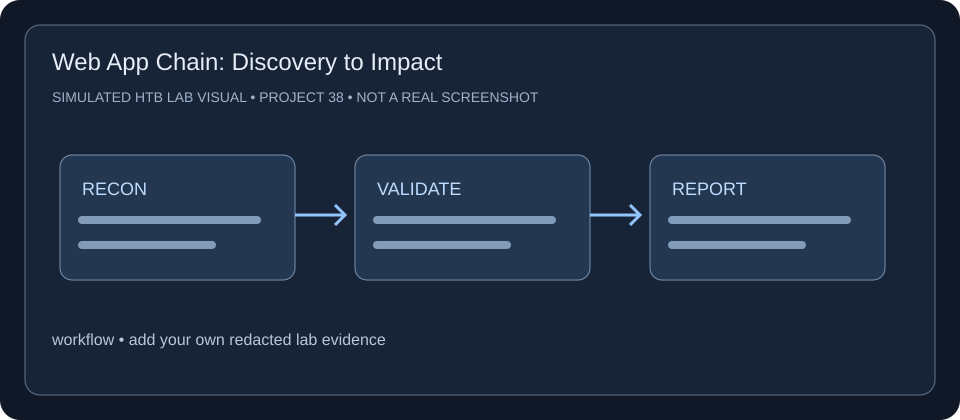
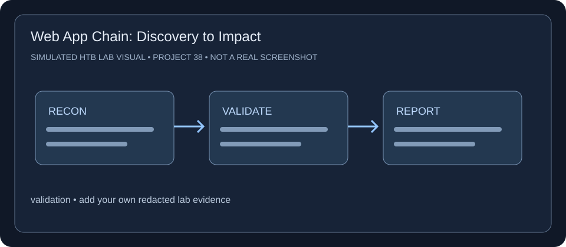

# Project 38: Web App Chain: Discovery to Impact

**Level:** Advanced  
**Environment:** HTB-assigned machine or Academy lab only

## Objective

Build an evidence-based web application attack narrative using multiple independently validated weaknesses.

## Scope and authorization

Use only HTB machines/labs whose rules explicitly permit the activity described. For exploitation or pivoting, prefer retired machines or dedicated Academy environments. Confirm exact target addresses and stop conditions before testing. No persistence, credential theft, out-of-scope lateral movement, or third-party access.

## Prerequisites and tools

Burp Suite; Nmap; ffuf; browser; curl

- Active HTB lab access and dedicated testing VM.
- Written scope notes and approved test window.
- Evidence directory with secrets and flags excluded.

## Procedure

Map the assigned application, identify input and authorization boundaries, and test one issue at a time. Chain findings only when each step is independently confirmed and HTB rules permit. Use synthetic records and stop at minimal impact proof; avoid destructive changes or data dumping.

## Expected outcome

A chain diagram showing entry point, trust boundary, validated weakness, bounded impact, and remediation.

## Screenshot and evidence requirements

Capture your own screenshots of (1) the HTB lab and scope, (2) relevant command or Burp output, and (3) manual validation, cleanup, or report evidence. Redact flags, credentials, tokens, and account identifiers. The diagrams below are simulated visuals for explanation only; they are not actual HTB screenshots or proof that the exercise has been executed.

## Simulated training illustrations

## Analysis and findings

| Dimension | Record |
|---|---|
| Scope | [Assigned machine, IP, service, and permitted actions] |
| Method | [Tool, version, command, and timestamp] |
| Observation | [Directly observed behavior] |
| Validation | [Minimal repeatable proof] |
| Impact | [Bounded impact in the synthetic lab] |
| Severity | [Rating and rationale] |
| Limitations | [What was not tested] |

## Defensive recommendations

Explain the root cause and prioritize remediation by risk. Recommend secure configuration, least privilege, patching, segmentation, strong authentication, and monitoring as applicable. Map validated findings to CWE, OWASP, or MITRE ATT&CK for defensive context; do not map speculative steps as confirmed behavior.

## Cleanup and retest

Close sessions and tunnels, remove temporary lab files, and confirm no persistence was introduced. Repeat a minimal safe validation after remediation and record the result.

## Deliverables

- Scope and methodology record.
- Three redacted screenshots from your own HTB lab run.
- Reproducible evidence and a concise impact narrative.
- Remediation, cleanup, and retest notes.

## References

- [Hack The Box](https://www.hackthebox.com/)
- [HTB Academy](https://academy.hackthebox.com/)
- [Burp Suite documentation](https://portswigger.net/burp/documentation)
