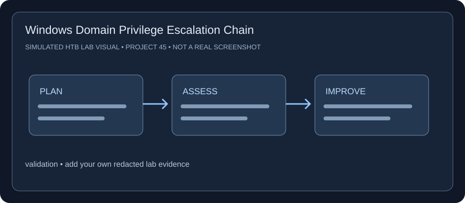

# Project 45: Windows Domain Privilege Escalation Chain

**Level:** Advanced  
**Environment:** HTB-assigned machine or Academy lab only

## Objective

Analyze a Windows domain privilege path using read-only evidence and a dedicated HTB AD lab.

## Scope and authorization

Use only an HTB target explicitly assigned to your account or a dedicated authorized training environment. Read the lab rules and define exact hosts, actions, time window, and stop conditions. No real-world stealth, persistence, credential theft, or out-of-scope access.

## Prerequisites and tools

BloodHound; LDAP tools; PowerShell; HTB AD lab

- Dedicated lab VM and current HTB scope information.
- Evidence folder and written rules of engagement.
- Redact credentials, flags, tokens, and personal data from all evidence.

## Procedure

Collect only lab-approved directory metadata. Trace group nesting, ACLs, delegation, and service-account relationships. Validate each edge using read-only queries and identify which control breaks the path. Do not dump secrets, abuse tickets, or execute remote commands.

## Expected outcome

A defensible path diagram, source evidence for each relationship, and prioritized control changes.

## Screenshot and evidence checklist

Capture your own (1) HTB lab context and scope, (2) relevant terminal/Burp/configuration output, and (3) validation, cleanup, or remediation evidence. Redact sensitive values. The three images below are simulated training diagrams only; they are not actual HTB screenshots or evidence of a completed test.

## Simulated training illustrations

## Assessment record

| Field | Record |
|---|---|
| Target / scope | [Assigned HTB target and permitted actions] |
| Tooling | [Tool versions and exact commands] |
| Observation | [Direct evidence] |
| Validation | [Minimal repeatable proof] |
| Impact | [Bounded lab impact] |
| Severity | [Rating and rationale] |
| Cleanup | [Sessions/files/tunnels closed] |
| Limitations | [Untested areas] |

## Defensive recommendations

Describe root cause, affected trust boundary, and practical mitigation. Prioritize least privilege, secure defaults, patching, segmentation, strong identity controls, monitoring, and tested recovery as relevant. Use CWE/OWASP/MITRE mappings only when they accurately describe observed behavior.

## Cleanup and retest

Close temporary sessions and tunnels, remove lab artifacts, and verify no persistence was introduced. Repeat the minimal safe validation after remediation and document the outcome.

## Deliverables

- Scope and rules of engagement.
- Three redacted screenshots from your own lab execution.
- Sanitized technical evidence and risk rationale.
- Remediation, cleanup, and retest notes.

## References

- [Hack The Box](https://www.hackthebox.com/)
- [HTB Academy](https://academy.hackthebox.com/)
- [Nmap Reference Guide](https://nmap.org/book/man.html)
